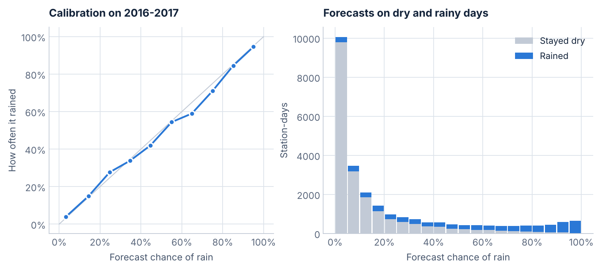
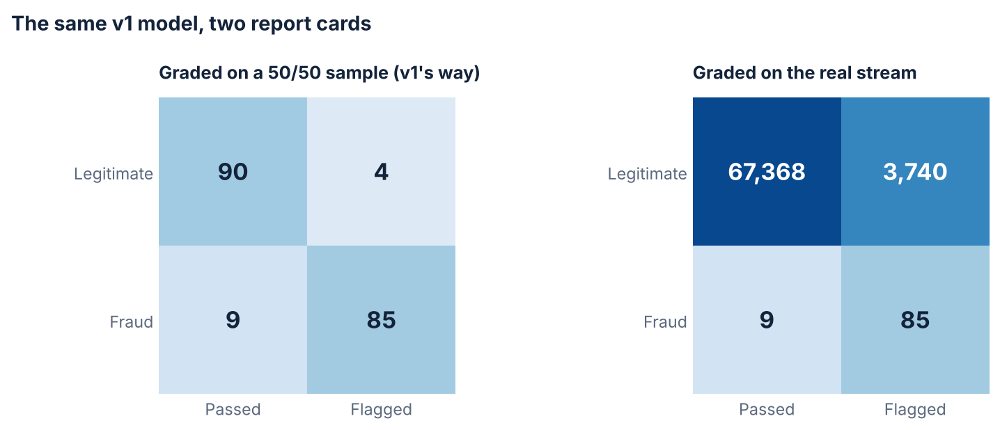
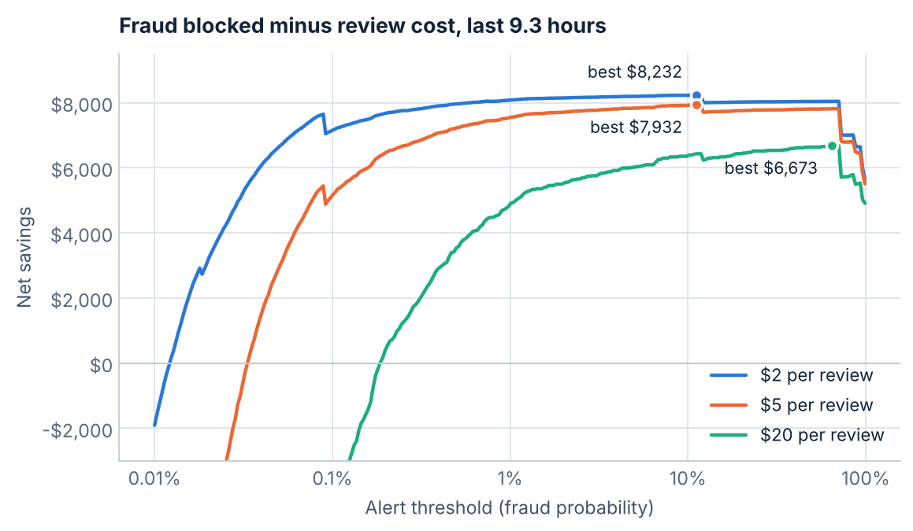
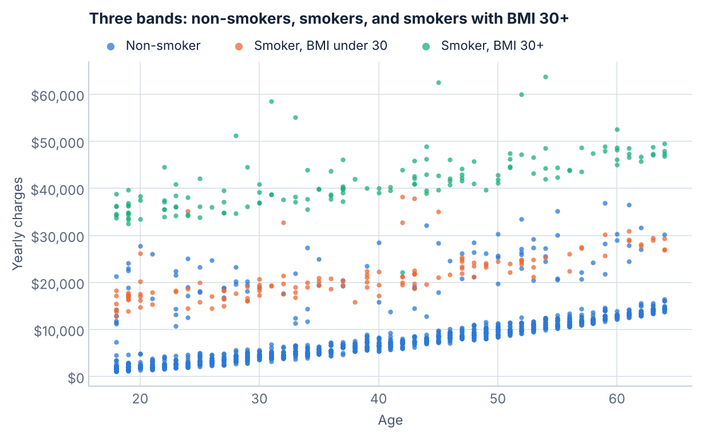
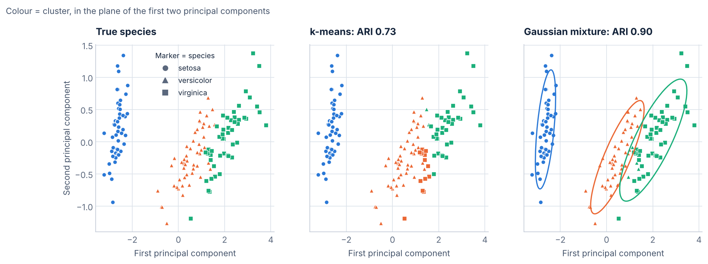
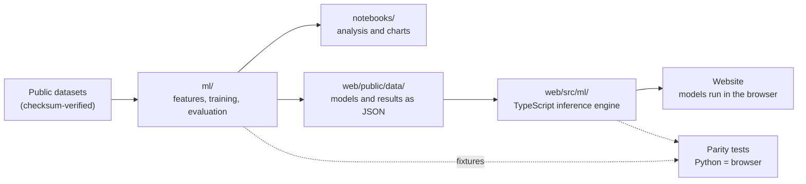

# Machine learning projects

[](https://github.com/Aadharsh21/ML-Projects/actions/workflows/ci.yml)


Four machine learning projects, rebuilt from my first notebooks into properly evaluated models. Each one is trained
in Python, graded the way it would be used, and exported with a small TypeScript engine so it can run live in a
browser with no server.

| Project | Question | v1 | v2 |
|---|---|---|---|
| [Rain tomorrow](#rain-tomorrow) | Will it rain tomorrow at one of 49 Australian weather stations? | 84.2% accuracy, ROC AUC 0.859 | **86.1% accuracy, ROC AUC 0.892** |
| [Fraud radar](#fraud-radar) | Which card transactions are fraud, when 99.8% of them are legitimate? | 85 of 94 frauds caught with **3,740 false alarms** | 70 of 94 caught with **8 false alarms**, +$7,803 net |
| [Insurance costs](#insurance-costs) | What will a customer's yearly medical charges be? | R² 0.714, error $4,146 | **R² 0.865, error $2,344**, plus a likely range |
| [Clustering](#clustering) | Can unsupervised learning rediscover the three iris species? | k-means, ARI 0.730 | **Gaussian mixture, ARI 0.904** |

Every number above is on data the model never trained on, and every one is reproduced by `python -m ml all`.

---

## Rain tomorrow

Predicts whether more than 1 mm of rain falls by 9am the next day, from one day of readings at a weather station
(140,787 station-days, 2007 to 2017). Trained on 2007-2014, tuned on 2015, graded on 25,710 days from 2016-2017,
the same split as v1.



- **Fixed a data leak.** v1 fitted its imputer and scaler on every row, test years included. Preprocessing now
  lives in a pipeline that only sees training rows.
- **Features a forecaster would use:** 9am-to-3pm changes in pressure, humidity, cloud and temperature, the time of
  year on a circle, station location, and wind directions as compass vectors.
- **LightGBM** handles the many missing readings natively (sunshine is missing on 48% of days) and combines readings
  non-linearly. A logistic regression given the same features stays at 84.3%, so the gain comes from the model.
- **Calibrated and explained.** When it says 70% it rains on about 70% of those days, and SHAP values break every
  forecast into the readings that drove it. Errors fall by 12% and Brier score from 0.114 to 0.101.

Read more: [notebook](notebooks/01-rain-tomorrow.ipynb), [code](ml/rain.py), [v1](notebooks/v1/LOGISTICWEATHER.ipynb)

## Fraud radar

Flags fraudulent transactions among 284,807 card payments (492 frauds) made over two days.



v1 balanced its data by undersampling, trained a logistic regression and reported 88% of fraud caught on a 50/50
test sample. Rebuilt and graded on the real stream, the same procedure catches 85 of 94 frauds but raises 3,740
false alarms in 9.3 hours, costing more in analyst time than the fraud it stops.

- **Chronological split.** Train on the first 60% of the timeline, stop training on the next 15%, test on the last
  25% (71,202 transactions, 94 frauds) at the true class balance.
- **Metrics that fit the problem:** average precision instead of accuracy, plus a cost model where each alert costs
  $5 to review and each missed fraud costs its amount.
- **LightGBM** on all training transactions: PR-AUC 0.711 to 0.803, with 70 of 94 frauds caught for 8 false alarms
  (about one every hour), blocking $8,193 of the $10,839 in fraud.
- **Decisions by money.** Net savings across thresholds and review costs, and an expected-loss rule (flag when
  P(fraud) x amount exceeds the review cost) that blocks more fraud dollars with fewer alerts.



Read more: [notebook](notebooks/02-fraud-detection.ipynb), [code](ml/fraud.py), [v1](notebooks/v1/CREDITFRAUD.ipynb)

## Insurance costs

Estimates yearly medical charges for 1,338 US customers from age, sex, BMI, children, smoking and region.



v1 fit charges against age alone, one line for smokers and one for non-smokers. The data has three bands, not two:
smokers with a BMI of 30 or more average $41,558, other smokers $21,363 and non-smokers $8,434.

- **Interactions instead of more model.** A linear regression with smoker x obesity and smoker x BMI terms beats
  LightGBM under 5x5 repeated cross-validation (R² 0.865 vs 0.855, error $2,344 vs $2,525) and every coefficient
  still reads in dollars.
- **A range, not just a number.** Errors are lopsided (about 1 in 12 customers pay far more than any model predicts,
  most likely from health conditions the data doesn't record), so the model reports the typical charge and the
  middle 80% of likely charges from out-of-fold residuals. On held-out customers the range contained the real
  charge 86% of the time.
- **Exact explanations.** With six inputs, Shapley values against the average customer are computed exactly.

Read more: [notebook](notebooks/03-insurance-costs.ipynb), [code](ml/insurance.py), [v1](notebooks/v1/LINEARINSURANCE.ipynb)

## Clustering

Can an algorithm that never sees the labels recover the three iris species from four flower measurements?



- **Choosing k honestly.** The elbow is soft at 2 to 3 and the silhouette score prefers 2: without labels, two of
  the species really do look like one group.
- **Scaling is a choice.** Standardizing drops agreement with the species from ARI 0.730 to 0.620, because it
  shrinks the informative petal measurements to the weight of the noisiest one.
- **Match the model to the shape.** k-means assumes round clusters; a full-covariance Gaussian mixture fits the
  elongated species and puts 96.7% of flowers in their species' cluster (k-means: 89.3%).

Read more: [notebook](notebooks/04-iris-clustering.ipynb), [code](ml/clustering.py), [v1](notebooks/v1/clustering.ipynb)

---

## How it fits together



The browser engine walks the exported LightGBM trees with LightGBM's own missing-value rules and ports its TreeSHAP
algorithm, so a web page gets the same probabilities (to 1e-9) and the
same explanations (to 1e-8) as the Python library. The Gaussian mixture code matches scikit-learn step for step.
A web page needs one import, `https://cdn.jsdelivr.net/gh/Aadharsh21/ML-Projects@v2.0.0/web/dist/index.js`, which
loads the models from the same release. Details in [`web/README.md`](web/README.md).

```
ml/                  Python package: data loading, one module per project, LightGBM exporter
notebooks/           v2 notebooks (executed); v1/ holds the originals
tests/               pytest: features, splits, exporter round trips, v1 replicas, Shapley maths
web/public/data/     exported models, test data and evaluation results
web/src/ml/          dependency-free TypeScript engine
web/src/site/        one loader per project for web pages, plus an in-browser parity self-test
web/dist/            the engine compiled to ES modules, which websites import from jsDelivr
web/tests/           Vitest parity tests against fixtures exported by Python
docs/images/         figures used in this README
```

## Run it yourself

```bash
git clone https://github.com/Aadharsh21/ML-Projects.git && cd ML-Projects
pip install -e ".[dev]"

python -m ml all      # downloads the data, trains, evaluates and exports all four projects
pytest                # Python tests

cd web && npm ci && npm test   # browser engine parity tests
```

The datasets download on first use from public mirrors and are checked against pinned SHA-256 hashes, so no Kaggle
account is needed. Each notebook also has an "Open in Colab" button. Exact library versions used for the published
results are in [`requirements-lock.txt`](requirements-lock.txt).

## Data

- Rain: [Rain in Australia](https://www.kaggle.com/datasets/jsphyg/weather-dataset-rattle-package), daily
  observations from the Australian Bureau of Meteorology
- Fraud: [Credit Card Fraud Detection](https://www.kaggle.com/datasets/mlg-ulb/creditcardfraud), Worldline and the
  Machine Learning Group of ULB
- Insurance: [Medical Cost Personal Datasets](https://www.kaggle.com/datasets/mirichoi0218/insurance)
- Iris: Fisher's iris data, bundled with scikit-learn
- Map outline: Natural Earth, via [world-atlas](https://github.com/topojson/world-atlas)

## The originals

The first versions of all four projects are kept unchanged in [`notebooks/v1`](notebooks/v1) for comparison. Each
v2 notebook opens by rebuilding its v1 model and explaining what it got wrong.
